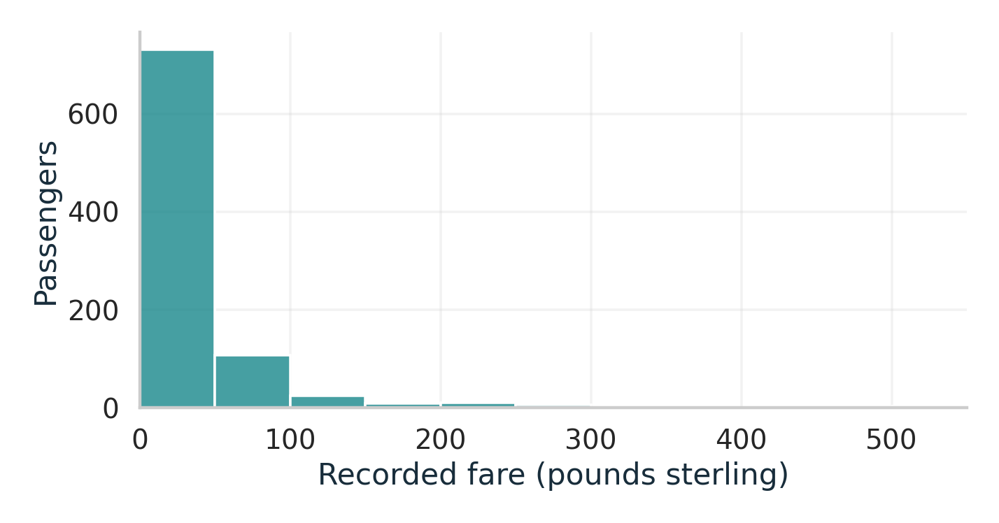
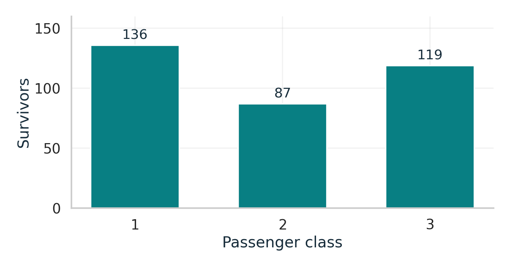
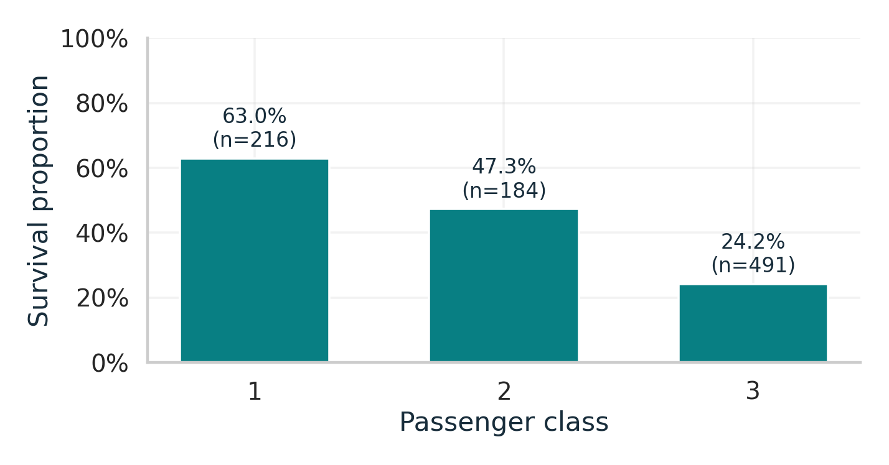
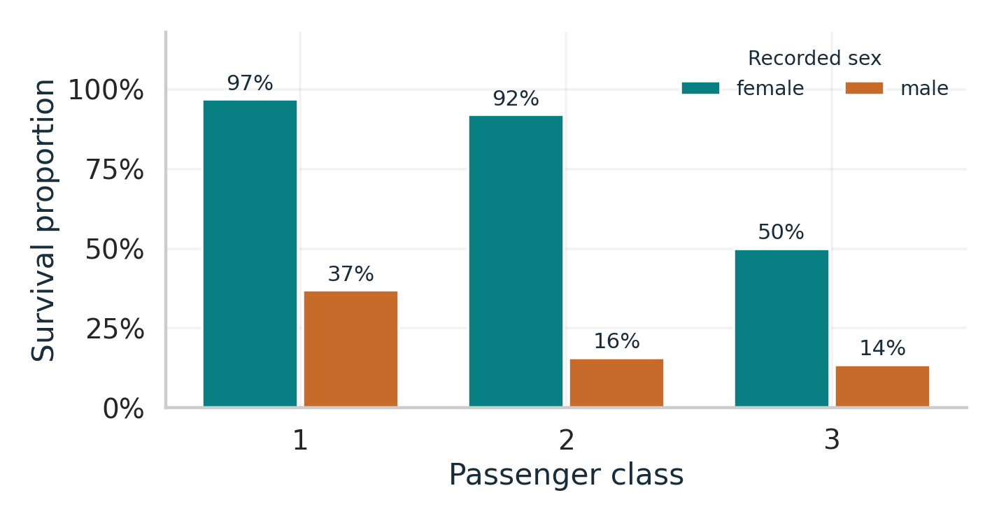

## Warmup: what would you ask next?

:::: {.columns}
::: {.column width="62%"}
{width="100%"}
:::
::: {.column width="38%"}
What do you notice?

What question would help you understand it?

Which view would you try next?
:::
::::

::: {.notes}
0:00-2:00. Brief title, 30 seconds alone, 30 seconds with a neighbor, then a response. Source: seaborn Titanic subset, 891 records, 50-pound bins. Keep the warmup short to preserve live coding and group time.
:::

## A question guides the next view

**Question:** What do we want to understand?

**Evidence:** Which observations, variables, and comparison help?

**Interpretation:** What does the view show, and what remains unresolved?

**Follow-up:** What should we examine next?

::: {.notes}
2:00-2:30. Briefly frame the cycle before opening the notebook. A broad first question is sufficient. Adapted from R for Data Science, https://r4ds.hadley.nz/EDA.html. The remaining demonstration happens in Positron.
:::

## Titanic: a live investigation

How does survival vary by passenger class?

891 passenger records in this subset. One row represents one passenger.

Open **`titanic_live_scaffold.ipynb`** in Positron.

The investigation will move from survivor counts to survival proportions, then add recorded sex through color.

::: {.notes}
2:30-9:00. Open notebooks/titanic_live_scaffold.ipynb with setup already run. Keep titanic_complete.ipynb in a second tab. Skip the optional histogram because students already saw it in the warmup. Use the count plot to motivate a denominator, then add sex to the grouped comparison. Ask for a prediction before the final plot. Keep age as an open next question. Use the three appendix plot slides only if needed for reference or a technical interruption.
:::

## Tornado data: what does one row mean?

**4,706 whole tornado tracks, 2015-2018**

| tornado_id | event_date | start_state | ef_rating | path_length_miles | max_width_yards |
|---|---|---|---:|---:|---:|
| 2015-549199 | 2015-01-03 | MS | 0 | 0.08 | 50 |
| 2015-549208 | 2015-01-03 | MS | 1 | 1.88 | 50 |

These are the first two records, shown to explain the schema.

A track can cross state lines. It still occupies one row.

::: {.notes}
9:00-10:00. One whole-track record per tornado after removing continuation rows and one exact duplicate. This is the NOAA SPC snapshot, not the old Wikipedia table. start_state identifies the track's beginning, not every state affected. Sources and processing are in sources.qmd and data/SOURCES.md.
:::

## The fields we can explore

| Information | Variables and meaning |
|---|---|
| Time | Start date, year, month, start hour in **CST** |
| Location | Starting state, start and end coordinates |
| Track size | Length in **miles**, maximum width in **yards** |
| Intensity | Ordered **EF rating**, sometimes missing |
| Outcomes | States affected, injuries, fatalities |

The identifier names a record. Its numeric-looking parts are not measurements.

::: {.notes}
10:00-11:00. These are groups of related fields among 17 total columns. Clock times use CST for every record, including outside that zone. Raw location counts and personal risk are different quantities. Point to the full data guide rather than reading every column name aloud.
:::

## EF ratings and missing information

EF0 through EF5 are **ordered damage categories** associated with estimated winds.

EF0 is valid. An unknown rating is missing, not zero.

This snapshot has **111 unknown ratings**. Keep those records until your question requires a decision about them.

The file has no duration, narrative summary, city name, population, or exposed-area denominator.

::: {.notes}
11:00-12:00. EF is based on damage surveys and estimated winds, not a direct wind-speed measurement. EF4 is not twice EF2. Briefly show the starter's loading cell if useful, but students should run it before class. A question using dates or track length does not automatically require dropping missing EF ratings. Source: https://www.weather.gov/oun/efscale and the bundled data availability check.
:::

## Round 1: question generation

**4 minutes with your original group**

Generate as many distinct questions as you can.

For each, identify the columns that could provide evidence.

The group with the most defensible distinct questions wins.

::: {.notes}
12:00-16:00. The data introduction now has its own three-minute block. Let students brainstorm before looking at results. If needed, offer generic prompts: distribution, comparison, relationship, time or space, unusual observations, missingness. Avoid suggesting specific tornado findings.
:::

## Round 2: one question to investigate

**2 minutes with your original group**

Our question is ...

We will examine these observations or groups ...

We need these variables and units ...

Our first plot or summary will help because ...

For a rate, name the denominator.

::: {.notes}
16:00-18:00. Select a question that is both interesting and answerable with the fields available. Clarify words like dangerous or worst by asking which measurement the group means.
:::

## Round 3: your investigation

**18 minutes with your original group**

Open **`tornadoes_starter.ipynb`**.

Make a first visualization and describe what it shows.

Name something it leaves unresolved, then investigate further.

Keep your plot available for sharing. An inconclusive finding can still be useful.

::: {.notes}
18:00-36:00. Leave this slide visible. Around minute 25 ask what the first plot leaves unresolved. Around minute 32 prompt students to save or access their plot and prepare an explanation. The starter loads data and checks types/missingness, with open cells for their own analysis. Refer syntax questions to plotting_reference.ipynb. Each original team member should be able to explain the investigation.
:::

## New groups: sharing investigations

**10 minutes with your new group**

Each person has about 2 minutes:

- What question did you investigate?
- What does your visualization show?
- How did your question or approach change?
- What would you investigate next?

Listeners: ask a useful follow-up question.

::: {.notes}
36:00-46:00. Use the random group generator. Aim for groups of 3-4, with original teammates separated where practical. Allow one minute to move, 6-8 minutes to explain, then discussion. Everyone shares their original team's investigation. No whole-class presentation round is scheduled.
:::

## What moved the investigation forward?

A visualization that changed a question

A question the available data could not fully answer

An approach you learned from someone else

One next question you would pursue

::: {.notes}
46:00-49:00. Take two or three brief contributions. Help distinguish what students observed from what they inferred. Invite a useful inconclusive result as well as a clear pattern.
:::

## Next class: passenger profiles

We compared Titanic passengers a few variables at a time.

How could we explore similarities across age, fare, family size, class, and embarkation together?

We will return to Titanic and add dimensionality reduction.

::: {.notes}
49:00-50:00. Motivation only, with no algorithm teaching today. Ask for one investigative move students will use again.
:::

## Reference: survivor counts

{height="380"}

This answers how many survived. What denominator would let us compare proportions?

::: {.notes}
Optional appendix. The primary demonstration happens live in Positron. Source: bundled Titanic data.
:::

## Reference: survival proportions

{height="380"}

Each denominator includes all passengers in that class in this subset.

::: {.notes}
Optional appendix. Source: bundled Titanic data. All 891 outcomes and class values are complete.
:::

## Reference: adding recorded sex

{height="380"}

The denominator now uses each class-by-sex group. These are descriptive associations.

::: {.notes}
Optional appendix. The completed notebook displays all six group sizes and survivor counts. Source: bundled Titanic data.
:::

## Sources

- [R for Data Science: EDA](https://r4ds.hadley.nz/EDA.html)
- [Seaborn Titanic data](https://github.com/mwaskom/seaborn-data)
- [NOAA SPC Severe Weather Database](https://www.spc.noaa.gov/wcm/#data)
- [National Weather Service: EF scale](https://www.weather.gov/oun/efscale)

The website's data guide documents the snapshots, units, and preparation.

::: {.notes}
Reference only. Tornado annual snapshots were retrieved from the public teaching mirror documented in sources.qmd. The package keeps the original raw files and preparation script.
:::
